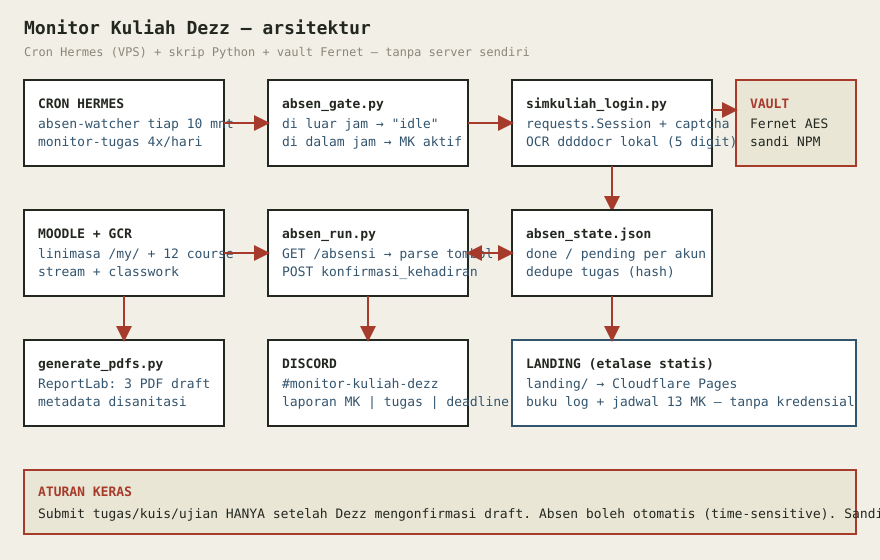

# Monitor Kuliah Dezz

Otomasi monitor kuliah Dezz (Nabil Aulia Dika, S1 Sistem Informasi USK):
absensi SIMKULIAH otomatis, pantau tugas Moodle & Google Classroom,
draft tugas + PDF siap kumpul — dengan aturan keras: **tidak ada submit
tanpa konfirmasi Dezz**.

Landing etalase (buku log): **https://monitor-kuliah-dezz.pages.dev/**

## Status

Dalam pengembangan aktif — dipakai harian via cron Hermes sejak
September 2026. Bukti operasi nyata ada di `data/templates/` (state
absen & dedupe tugas Oktober 2026).

## Cara kerja (ringkas)

```
cron 10 mnt → absen_gate.py → idle? (stop, hemat token)
                          └─ MK aktif → absen_run.py
                              ├─ login SIMKULIAH (session + captcha OCR ddddocr)
                              ├─ parse halaman absensi → POST konfirmasi_kehadiran
                              └─ update absen_state.json + lapor Discord
cron 4x/hari → Moodle linimasa + 12 course → tugas baru? → dedupe hash → lapor
tugas baru → kerjakan draft → generate_pdfs.py → Dezz konfirmasi → submit
```

Arsitektur lengkap: [docs/ARCHITECTURE.md](docs/ARCHITECTURE.md)



## Menjalankan (mode aman — tanpa kredensial)

```bash
# 1. Cek jendela absen hari ini (data contoh di data/)
MONITOR_KULIAH_DATA_DIR=data python3 scripts/check_schedule.py
# {"now": "2026-11-19T16:51:59+07:00", "hari": "Kamis",
#  "absen_aktif": [{"kode": "SINF2023", "nama": "SISTEM OPERASI", ...}]}

# 2. Cek gerbang cron
MONITOR_KULIAH_DATA_DIR=data python3 scripts/absen_gate.py
# SINF2023(pending:dezz,rizki) @16:52

# 3. Demo satu run absen (parse HTML contoh — TIDAK login, TIDAK POST)
python3 scripts/absen_run.py --demo

# 4. Tes (26 tes, tanpa jaringan/kredensial)
python3 -m unittest discover -s tests -v
```

Jalankan nyata (butuh vault + venv captcha di server) — lihat
[docs/DEPLOYMENT.md](docs/DEPLOYMENT.md) dan
[docs/absensi-simkuliah.md](docs/absensi-simkuliah.md).

## Struktur

```
scripts/                  skrip automation (absen, login, PDF, sweep, gate statis)
  check_schedule.py       window absen dari jadwal.json
  absen_gate.py           gerbang cron (idle di luar jam kuliah)
  absen_run.py            watcher absensi + --demo
  simkuliah_login.py      login SIMKULIAH + captcha ddddocr
  krs_login.py            login KRS USK (Laravel + CSRF)
  generate_pdfs.py        3 PDF laporan tugas (ReportLab, metadata disanitasi)
  advisory-sweep.py       sweep OSV dependensi produksi
  check-static.py         gate P0 anti-slop + OG (landing)
  make-og-image.py        generator og-image.png (PIL)
data/
  jadwal-kuliah.json      13 MK, 21 SKS, Senin–Sabtu
  templates/              contoh absen_state.json + state.json (Okt 2026)
  examples/               contoh halaman absensi (fixture --demo + tes)
docs/                     soul, absensi, moodle, tugas-pdf, submission-cron,
                          DESIGN.md, ARCHITECTURE.md, TESTING.md, DEPLOYMENT.md
landing/                  etalase statis (buku log) → Cloudflare Pages
tests/                    26 tes unittest (jadwal, parser, demo, PDF)
```

## Keamanan

- **Tidak ada kredensial di repo.** Sandi hanya dari vault Fernet di server
  (`MONITOR_KULIAH_VAULT_KEY` / `MONITOR_KULIAH_VAULT_ENC`); skrip tidak
  pernah mem-print atau me-log sandi. Gitleaks memindai seluruh riwayat di CI.
- Tugas/kuis/ujian **tidak pernah di-submit** sebelum Dezz melihat draft dan
  mengonfirmasi. Absen boleh otomatis karena time-sensitive.
- PDF draft disanitasi (metadata + teks) sebelum dikumpulkan ke dosen.

## Lisensi

MIT — lihat [LICENSE](LICENSE).
