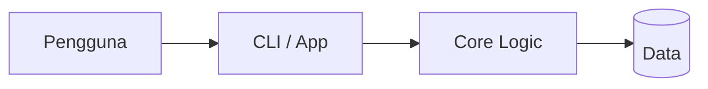

# Monitor Kuliah Dezz

Monitor Kuliah Dezz — project oleh Nabil Aulia Dika (dezzorigin).

## Status Proyek

**Dalam pengembangan** _(README ada)_

## 📋 Tech Stack

Python

## 🏗️ Arsitektur



## 📁 Struktur Proyek

```
01_SOUL_AND_CONFIG/
02_ABSENSI_SIMKULIAH/
03_ELEARNING_MOODLE/
04_MENGERJAKAN_TUGAS_DAN_PDF/
05_SUBMISSION_DAN_CRON/
LICENSE
PRD.md
README.md
```

## 🚀 Getting Started

```bash
# Install dependencies
npm install

# Jalankan development server
npm run dev
```

> Untuk project HTML/Python/Go, lihat instruksi di atas atau file konfigurasi.

## 📄 Lisensi

MIT — lihat [LICENSE](./LICENSE).

---
_Dikembangkan oleh **dezzorigin** (Nabil Aulia Dika)._
