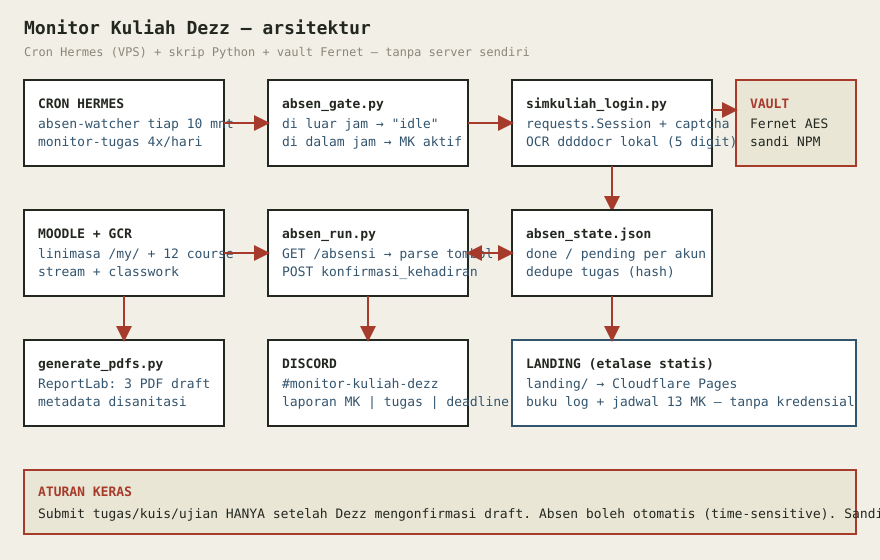

# Arsitektur — Monitor Kuliah Dezz



Sistem ini bukan server dan bukan aplikasi web — ini **otomasi cron +
skrip Python** yang berjalan di VPS Hermes, ditambah soul Discord dan
landing statis sebagai etalase.

## Komponen

| Komponen | Peran | File |
|---|---|---|
| Cron Hermes | Pemicu terjadwal (lihat `docs/submission-cron.md`) | `docs/cron_jobs_export.json` |
| `absen_gate.py` | Gerbang hemat token: `idle` di luar jam kuliah | `scripts/absen_gate.py` |
| `check_schedule.py` | Hitung window absen dari `jadwal.json` (15 mnt sebelum s/d 30 mnt setelah mulai) | `scripts/check_schedule.py` |
| `simkuliah_login.py` | Login SIMKULIAH: session + captcha OCR lokal | `scripts/simkuliah_login.py` |
| `krs_login.py` | Login KRS USK (Laravel, CSRF token) | `scripts/krs_login.py` |
| `absen_run.py` | Satu run watcher: parse halaman absensi → POST konfirmasi → update state | `scripts/absen_run.py` |
| `generate_pdfs.py` | 3 PDF laporan tugas (ReportLab, metadata disanitasi) | `scripts/generate_pdfs.py` |
| Vault (Fernet AES) | Satu-satunya tempat sandi — di luar repo | `/opt/data/vault/` di server |
| `absen_state.json` / `state.json` | State + dedupe (hash instruksi tugas) | `data/templates/` (contoh) |
| Soul Discord | Persona + aturan mengikat di channel #monitor-kuliah-dezz | `docs/soul.md` |
| Landing | Etalase statis (buku log) — tanpa kredensial, tanpa state nyata | `landing/` → Cloudflare Pages |

## Alur absensi (ringkas)

```
cron 10 mnt → absen_gate.py → idle? (stop)
                          └─ MK aktif → absen_run.py
                              ├─ vault_password() (Fernet decrypt, tidak diprint)
                              ├─ simkuliah_login.login() (session + ddddocr, retry ≤6)
                              ├─ GET /index.php/absensi → parse_absensi()
                              │     ├─ tombol konfirmasi-* → POST konfirmasi_kehadiran
                              │     └─ 'sudah absen' / 'belum waktu' → catat status
                              ├─ verifikasi ulang (tombol hilang / 'success')
                              └─ update absen_state.json + lapor Discord
```

Detail lengkap (termasuk kenapa SweetAlert dilewati dan kenapa captcha
terikat sesi): `docs/absensi-simkuliah.md`.

## Alur tugas

```
cron 06/12/18/00 WIB → Moodle linimasa + 12 course → tugas/kuis baru?
    → bandingkan hash instruksi dengan state.json → baru/berubah → lapor Discord
    → Dezz minta draft → kerjakan (docs/tugas-pdf.md) → generate_pdfs.py
    → Dezz konfirmasi → submit manual via browser → status 'Submitted for grading'
```

Kuis/ujian tidak pernah dikerjakan otomatis — hanya dilaporkan.

## Data

- `data/jadwal-kuliah.json` — 13 MK, 21 SKS, Senin–Sabtu (Sabtu 08:00 bentrok
  dua MK, keduanya dicek).
- `data/templates/absen_state.json` — contoh state absen 15 Okt 2026.
- `data/templates/state.json` — contoh state dedupe tugas Moodle + status GCR.
- `data/examples/absensi_contoh.html` — contoh halaman absensi SIMKULIAH
  (format tombol 2026) untuk `--demo` dan tests.

## Jalur data (portabel)

Semua skrip membaca `MONITOR_KULIAH_DATA_DIR` (default
`/opt/data/monitor-kuliah` — jalur server Hermes). Di repo ini, contoh
data ada di `data/`:

```bash
MONITOR_KULIAH_DATA_DIR=data python3 scripts/check_schedule.py
MONITOR_KULIAH_DATA_DIR=data python3 scripts/absen_gate.py
```

Vault diatur lewat `MONITOR_KULIAH_VAULT_KEY` /
`MONITOR_KULIAH_VAULT_ENC` (default `/opt/data/vault/vault.key` dan
`vault.json.enc`). Lihat `.env.example`.

## Keamanan

- Tidak ada kredensial di repo — gitleaks memindai seluruh riwayat di CI.
- Sandi tidak pernah diprint, di-log, atau ditulis ke file oleh skrip.
- PDF draft disanitasi (metadata + teks) sebelum dikumpulkan — lihat
  `docs/tugas-pdf.md`.
- `verify=False` dipakai ke SIMKULIAH/KRS karena sertifikat kampus sempat
  bermasalah di server; lalu lintas tetap HTTPS ke domain kampus saja.
